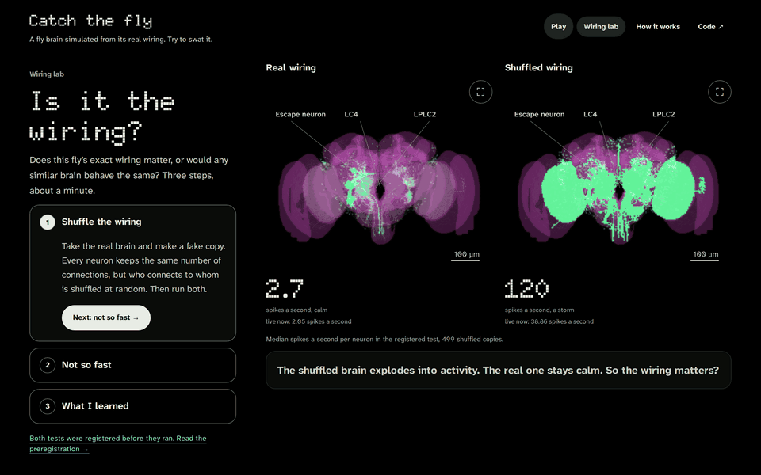
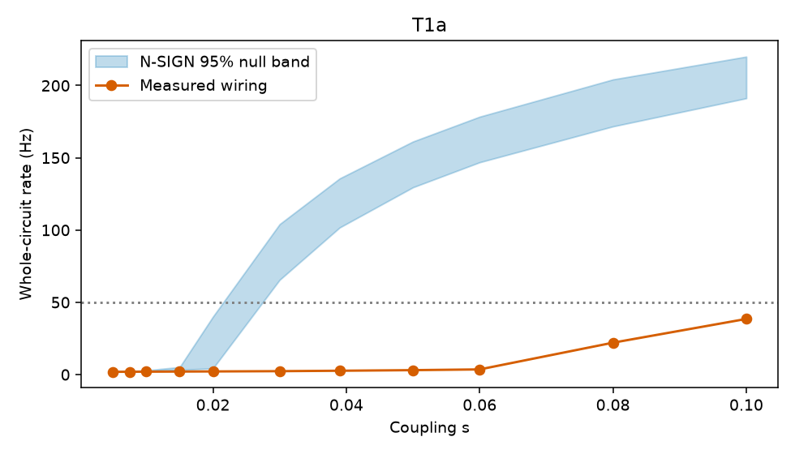
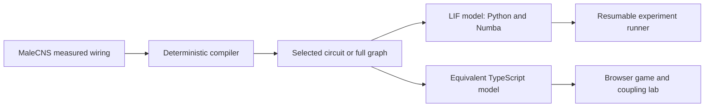

# Catch the Fly

A simulated fly driven by measured neural wiring. Try to swat it, then compare measured and shuffled wiring under the same model.



**[Play Catch the Fly](https://alpi157.github.io/internet-vs-one-fly/)** · Live after deployment.
Tap for a flick or hold for a slower, wider strike. Open the coupling lab to compare measured and scrambled wiring side by side.

## The finding

In this model, measured wiring stays stable at couplings where degree- and sign-matched shuffles saturate: the original circuit averaged 2.65 Hz at coupling 0.039, compared with null medians of 110.73 to 119.78 Hz, with Holm p 0.008 in each family.

The strength-preserving comparison did not replicate the registered stability result in the 2,641-neuron circuit: N-STRENGTH had Holm p 0.088 for both metrics.

The stability difference also holds in the full 166,700-neuron MaleCNS graph, under this model and for the families that reached significance. N-SIGN reached Holm p 0.04; N-STRENGTH did not replicate (Holm p 0.14).

The stability difference also holds in the 43,894-neuron circuit, under this model and for the families that reached significance. N-FULL and N-SIGN each reached Holm p 0.02 for both metrics; N-STRENGTH did not replicate: its critical-coupling comparison was not significant (Holm p 1), and its measured rate was higher, the opposite direction (Holm p 0.02).

Uniform model neurons, assumed transmitter signs and simplified inputs limit these findings to this model. Escape and walking comparisons remain insufficient; no claim concerns what living flies require.

The [original pre-registration](docs/preregistration-v2.md) was publicly timestamped on **2026-10-14**, before execution. The [robustness protocol](docs/preregistration-v2.1.md) was published on **2026-10-15**, before its run; [the receipt records the exact UTC publication time and commit](docs/preregistration-receipt-v2.1.json).



The clip demonstrates the original N-SIGN comparison, not the strength-preserving control. The lab scramble is the first seed at the family's median critical coupling, selected by a fixed rule. Heat and meters use recorded simulation spikes; the speed factor reports simulated time per wall second. The strength-preserving comparisons above limit the broader interpretation.

## How it works



Visual features enter neural input ports. Spikes reach a motor decoder that receives no hand position, distance or future collision information. The previous command drives the current interval, so a new escape cannot alter an earlier hit.

## Engineering highlights

- Bit-exact state-digest checks cover Python, Numba, TypeScript, Chromium, Firefox and WebKit within the declared execution envelope.
- Publicly timestamped protocols and freeze manifests pin code, graph identities, assumptions, seeds and analysis before confirmatory execution.
- Atomic per-task results and deterministic seeds support resume independently of worker scheduling. The robustness run took **7.11 hours** on a **24-thread** host, with peak process RSS **5.17 GiB**.
- Cached canvas rendering raised mobile-viewport WebKit frame opportunities from **38.9 to 62.5 fps** in the comparable measurement window. Active mobile gameplay measured **58.4 fps**; the coupling lab measured **62.3 fps**. These are headless desktop engines, not physical iPhone measurements.
- The recorded initial compressed build scope is **1.38 MB**, with the **0.97 MB** coupling lab and **1.48 MB** lesion lab loaded separately. Missing neural observations remain missing.
- Offline fixtures, cross-runtime parity, scripted bots, browser screenshots, production base-path checks and fresh-clone acceptance make the implementation inspectable. [Measurement details](docs/measurements-v2f.json) state each scope.

## Run locally

Use the locked Python and Node development setup. Committed browser data means local play needs no credentials, GPU or connectome download.

```sh
uv sync --extra dev --locked
npm --prefix apps/play ci
npm --prefix apps/play run dev
```

Open the localhost URL printed by Vite with the `/internet-vs-one-fly/` base path. The Pages workflow is manual-only. Deployment remains an operator action.

## For scientists

The game executes a calibrated **5,555-neuron** circuit. The coupling lab executes **2,641 neurons** in each simulation. The full accepted graph contains **166,700 neurons**. Original body IDs and contact counts remain separate from executable weights. Unknown signs remain disabled. Soma maps use relative coordinates with unverified physical units and anatomical orientation.

The model uses uniform current-based LIF neurons, assumed source signs, feature-level vision, declared turn-direction assumptions and abstract takeoff physics. Noise excludes visual and decoder ports. Moving the coupling slider explicitly resets both simulations with the same seed; normal game rounds retain neural state. Dropping the hand adds visual input to both neural simulations.

**Escape and walking comparisons remain insufficient.** The selected real circuit calibrated, but only 21/199 N-FULL, 0/199 N-CONTEXT, 37/199 N-SIGN nulls did. The preregistered threshold was not reached. There are no confirmatory escape or walking superiority claims.

### CONFIRMATORY robustness

| Test | Circuit | Family | Metric | Real | Null median | 95% null band | p | Holm p | Verdict |
|---|---|---|---|---:|---:|---|---:|---:|---|
| H0-STR | T1a | N-STRENGTH | H0a | >0.1 (censored) | 0.1 | [0.08, >0.1 (censored)] | 0.06 | 0.088 | Not significant; does not establish the stability difference |
| H0-STR | T1a | N-STRENGTH | H0b | 2.65068 | 4.40042 | [2.66566, 8.81602] | 0.044 | 0.088 | Not significant; does not establish the stability difference |
| H0-FULL | FULL | N-SIGN | H0b-FULL | 15.3095 | 36.8414 | [34.5855, 38.8966] | 0.02 | 0.04 | Supports the registered stability direction |
| H0-FULL | FULL | N-STRENGTH | H0b-FULL | 15.3095 | 14.4829 | [13.4391, 15.4853] | 0.14 | 0.14 | Not significant; does not establish the stability difference |
| H0-T2 | T2 | N-FULL | H0a | >0.1 (censored) | 0.039 | [0.03, 0.039] | 0.01 | 0.02 | Supports the registered stability direction |
| H0-T2 | T2 | N-FULL | H0b | 10.0006 | 72.0766 | [52.6434, 87.3415] | 0.01 | 0.02 | Supports the registered stability direction |
| H0-T2 | T2 | N-SIGN | H0a | >0.1 (censored) | 0.05 | [0.05, 0.06] | 0.01 | 0.02 | Supports the registered stability direction |
| H0-T2 | T2 | N-SIGN | H0b | 10.0006 | 29.658 | [16.9921, 42.2049] | 0.01 | 0.02 | Supports the registered stability direction |
| H0-T2 | T2 | N-STRENGTH | H0a | >0.1 (censored) | >0.1 (censored) | [>0.1 (censored), >0.1 (censored)] | 1 | 1 | Not significant; does not establish the stability difference |
| H0-T2 | T2 | N-STRENGTH | H0b | 10.0006 | 4.98657 | [2.72369, 6.99636] | 0.01 | 0.02 | Opposite direction: measured rate is higher |

Critical coupling above the tested grid is censored. A non-significant result does not establish equivalence. A significant opposite-direction rate does not support the registered stability claim. Full [findings](docs/findings-v2f.md) include figures, null bands, censoring and exact [result tables](docs/results-v2f.json).

### EXPLORATORY checks

EXPLORATORY E1: measured leading signed eigenvalues are 3.04103 for T1a and 6.91182 for T2, above every family median; 2 null eigenvalues did not converge and remain missing. Structure and Spearman associations are descriptive, not a causal mechanism test.

EXPLORATORY E2a (glutamate treated as excitatory): measured rate 139.557 Hz versus null median 264.911 Hz; measured critical coupling 0.015 versus null median 0.01. Measured rate percentile 0%; critical-coupling percentile 100%. Both measured and shuffled wiring saturate under this sign assumption.

EXPLORATORY E3-low (lower noise): measured rate 1.52497 Hz versus null median 116.096 Hz; measured critical coupling >0.1 (censored) versus null median 0.03. Measured rate percentile 0%; critical-coupling percentile 100%.

EXPLORATORY E3-high (higher noise): measured rate 4.13383 Hz versus null median 119.603 Hz; measured critical coupling >0.1 (censored) versus null median 0.03. Measured rate percentile 0%; critical-coupling percentile 100%.

EXPLORATORY E2b: preregistered SKIPPED. Compiled predicted_nt_confidence is copied verbatim, but the source confidence semantics and its relationship to consensus_nt signs are not established. No threshold interpretation is invented.

[Original findings](docs/findings-v2e.md) · [Original tables](docs/results-v2e.json) · [Robustness freeze manifest](profiles/freeze-v2.1.json).

Verify the existing raw records without simulating new trials:

```sh
uv pip install --no-deps -r profiles/requirements-v2.1.txt
uv run python experiments/v2f_analyze.py --out evidence/V2F/results
uv run python experiments/v2f_analyze.py --out evidence/V2F/results --verify
uv run python experiments/v2f_publish.py --check
```

Analysis takes seconds on this host after the records are available. Reproducing the registered experiment from scratch requires the pinned sources and graphs in the [data guide](docs/data-attribution.md), plus the exact commands and worker plan in the [protocol](docs/preregistration-v2.1.md). The completed run's elapsed time above is a measurement, not a runtime guarantee. Do not patch a frozen executable to continue an attempt.

## Limitations

The strength-preserving comparisons did not replicate the registered stability result. There is no learning, plasticity, realistic biomechanics, human-player study, public verification service or shared score. Scripted bot results are engineering evidence, not human usability evidence. EXPLORATORY analyses cannot support confirmatory claims. A difference from a shuffle does not establish biological necessity or identify a unique mechanism.

## Data attribution, citation and license

MaleCNS is published by the Male CNS Connectome project, including FlyEM at HHMI Janelia, Cambridge, MRC LMB and Google Research. The [official download page](https://male-cns.janelia.org/download/) identifies the CC-BY license. Cite the [MaleCNS study](https://www.cell.com/cell/fulltext/S0092-8674%2826%2900942-6) and [dataset release](https://male-cns.janelia.org/).

Source URLs and observed hashes are in [source-lock.json](profiles/source-lock.json). Browser asset attribution and hashes accompany the committed data. See [CITATION.cff](CITATION.cff) for software and dataset citation metadata. Code is [MIT licensed](LICENSE); underlying and derived MaleCNS data remains [CC-BY](LICENSE-DATA.md).
