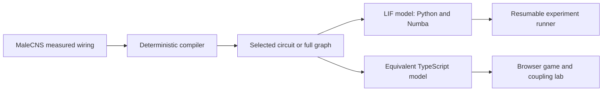

# Catch the Fly

A simulated fly driven by measured neural wiring. Try to swat it, then shuffle the wiring and compare what happens.


**[Play Catch the Fly](https://alpi157.github.io/internet-vs-one-fly/)** · Live after deployment.
Six strikes, one fly. Tap for a flick or hold for a slower, wider strike.
Open the coupling lab to run measured and scrambled wiring side by side.

## The finding

In this model, measured wiring stays stable at couplings where degree- and
sign-matched shuffles saturate. In the 2,641-neuron circuit at coupling 0.039,
measured wiring averaged **2.65 Hz**, compared with null medians of **110.73 to
119.78 Hz** across three families of 499 shuffles each; both registered stability
metrics reached Holm p = **0.008** in every family. The
[pre-registration](docs/preregistration-v2.md) was publicly timestamped on
**14 October 2026**, before those confirmatory runs. A separately
[registered robustness study](docs/preregistration-v2.1.md), published
**15 October 2026**, is running strength-preserving, larger-circuit and full-graph
checks; results are **pending**, so no robustness replication is claimed yet.
These results concern uniform model neurons, assumed transmitter signs and
simplified inputs, and do not establish what real flies require.


The coupling lab uses the same registered noise and coupling settings. Its
scramble is the first N-SIGN seed at the family's median critical coupling,
selected by a fixed rule. Heat and rate meters come from recorded simulation
spikes. The displayed speed factor reports actual simulated time per wall second.

## How it works



Visual features enter neural input ports. Spikes reach a motor decoder that
receives no hand position, distance or future collision information. The previous
command drives the current interval, so a new escape cannot alter an earlier hit.

## Engineering highlights

- Bit-exact state-digest checks cover Python, Numba, TypeScript, Chromium, Firefox
  and WebKit within the declared float64, integer-clock execution envelope.
- Publicly timestamped protocols and freeze manifests pin code, graph identities,
  model assumptions, trial seeds and analysis before confirmatory execution.
- Atomic per-task results and deterministic seeds support resume independently of
  worker scheduling. The original complete run took **10.0 hours on 12 workers**;
  the registered follow-up projection is **9.35 hours**, with actual use pending.
- A cached canvas rendering pass raised mobile-viewport WebKit's measured frame
  opportunity rate from **38.9 to 62.5 fps** on this development host. The coupling
  lab measured **62.2 fps** while its simulations ran. The mobile game also
  reached **58.4 fps** during active simulation. These are headless desktop
  engine measurements, not measurements on an iPhone.
- Initial compressed build scope is **1.38 MB**, with the **0.97 MB** coupling
  lab and **1.48 MB** lesion lab loaded separately. Neural replay and exported
  clips use recorded observations. Missing observations remain missing.
- Offline fixtures, cross-runtime parity, scripted bots, browser screenshots,
  production base-path checks and fresh-clone acceptance make the implementation
  inspectable. [Measurement details](docs/measurements-v2f.json) state each scope.

## Run locally

Python 3.12, uv and Node 24 are used by the locked development setup. Committed
browser data means local play needs no credentials, GPU or connectome download.

```sh
uv sync --extra dev --locked
npm --prefix apps/play ci
npm --prefix apps/play run dev
```

Open `http://127.0.0.1:5173/internet-vs-one-fly/`.
The Pages workflow is manual-only. Deployment remains an operator action.

## For scientists

The game executes a calibrated 5,555-neuron circuit. The coupling lab executes
2,641 neurons in each simulation. The full accepted dataset contains 166,700
neurons. Original body IDs and biological contact counts remain separate from
executable weights. Unknown signs remain disabled. Soma maps use relative x/z
coordinates with unverified physical units and anatomical orientation.

The model uses uniform current-based LIF neurons, predicted source signs,
feature-level vision, declared turn-direction assumptions and abstract takeoff
physics. Noise enters interior neurons and excludes visual and decoder ports.
The coupling slider explicitly resets both simulations with the same noise seed;
normal game rounds retain neural state. Dropping the hand adds the actual visual
stimulus to both flies, whose movement still comes through the network.

**Escape and walking comparisons remain insufficient.** The selected real circuit
calibrated, but only 21/199 N-FULL, 0/199 N-CONTEXT and 37/199 N-SIGN nulls did,
below the registered threshold of 149. There are no confirmatory H1 or H2
superiority claims. The larger game circuit's stability replication is descriptive.

| Registered comparison | Status |
|---|---|
| Original T1a stability, N-FULL / N-CONTEXT / N-SIGN | Positive in all three families; Holm p 0.008 for both metrics |
| Strength-preserving T1a stability, 499 N-STRENGTH nulls | Running; analysis pending |
| T2 stability, 199 nulls per N-FULL / N-SIGN / N-STRENGTH family | Pending |
| Full-graph rate, 99 nulls per N-SIGN / N-STRENGTH family | Running; analysis pending |
| EXPLORATORY mechanism, glutamate sign and noise checks | Pending; descriptive only |
| EXPLORATORY confidence-threshold sign check | Skipped: confidence semantics relative to consensus signs are unestablished |

[Original findings](docs/findings-v2e.md) · [Original result tables](docs/results-v2e.json)
· [Robustness protocol](docs/preregistration-v2.1.md)
· [Robustness freeze manifest](profiles/freeze-v2.1.json)
· [Public freeze receipt](docs/preregistration-receipt-v2.1.json).

A small verification path uses committed fixtures and browser assets:

```sh
npm --prefix packages/kernel-ts ci
npm --prefix packages/kernel-ts run test:fixture
npm --prefix apps/play test
npm --prefix apps/play run build
```

The scientific run requires the pinned raw sources and compiled graph arrays.
After acquiring and compiling the sources as documented in the
[data guide](docs/data-attribution.md), use the locked base environment and
separately pinned sparse-analysis dependency. The pilot-based projection is
9.35 hours on this 24-thread host; saturated nulls may take longer.

```sh
uv run flybench data fetch --lock profiles/source-lock.json --out data/raw --report evidence/V2F/sources.json
uv run flybench data compile --lock profiles/source-lock.json --selection profiles/accepted-neurons.json --out data/compiled/full
uv run python -m flybench.circuit build-v2 --out evidence/V2F/circuit-build
uv pip install --no-deps -r profiles/requirements-v2.1.txt
uv run python -m pytest -q tests/test_v2f.py tests/test_v2f_freeze.py
OPENBLAS_NUM_THREADS=1 OMP_NUM_THREADS=1 uv run python experiments/v2f_run.py --resume --out evidence/V2F/results
uv run python experiments/v2f_analyze.py --out evidence/V2F/results
uv run python experiments/v2f_analyze.py --out evidence/V2F/results --verify
```

Verification recomputes all tables from raw records and checks both freeze
manifests. A changed frozen file or recorded scientific defect stops execution.
Do not patch a frozen executable to continue an attempt.

## Limitations

This is a model of selected wiring, with full-graph robustness still pending.
It has no learning, plasticity or realistic biomechanics. There is no human-player
study, public verification service or shared score. Scripted bot results are
engineering evidence, not human usability evidence. EXPLORATORY analyses cannot
support confirmatory claims. An observed difference from a shuffle does not
establish a biological necessity or identify a unique mechanism.

## Data attribution, citation and license

MaleCNS v1.0 is published by the Male CNS Connectome project, including FlyEM at
HHMI Janelia, Cambridge, MRC LMB and Google Research. The
[official download page](https://male-cns.janelia.org/download/) identifies the
CC-BY license. Cite the [MaleCNS study, Cell (2026)](https://www.cell.com/cell/fulltext/S0092-8674%2826%2900942-6)
and [dataset release](https://male-cns.janelia.org/).

Source URLs and observed SHA-256 values are in [source-lock.json](profiles/source-lock.json).
Browser asset attribution and hashes accompany the committed data.
See [CITATION.cff](CITATION.cff) for software and dataset citation metadata.
Code is [MIT licensed](LICENSE), copyright 2026 Alpar. Underlying and derived
MaleCNS data remains [CC-BY](LICENSE-DATA.md).
