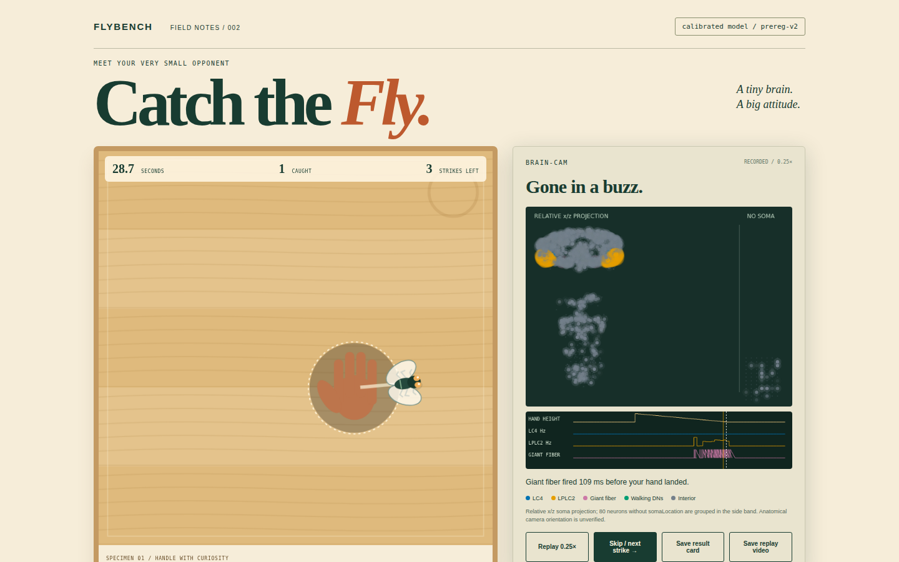

# Catch the Fly

Six strikes against a simulated fly driven by measured neural wiring.



## What it is

Catch the Fly is a browser game whose walking, turning and takeoff requests come
from a spiking neural simulation. It executes a 5,555-neuron MaleCNS circuit locally
and replays recorded spikes after each strike. The accompanying experiment tests
measured wiring against equally calibrated shuffled graphs.

## What is real and what is simplified

The T1b graph contains 759,305 measured directed connections representing 7,397,244
biological contacts. Original body IDs and contact counts survive compilation and
lossless browser transport. The model uses uniform LIF neurons, predicted source
signs, feature-level vision, assumed turn directions and abstract takeoff physics.
Unknown signs remain disabled; missing soma coordinates remain explicitly missing.
The brain map uses relative x/z positions with unverified physical units and
anatomical orientation. It shows recorded spikes, including fading afterglow,
without inventing neural observations.

## Results and status

V2E is submitted for review. The full experiment and frozen analysis completed;
hosting has not been enabled. The [public preregistration tag](https://github.com/Alpi157/internet-vs-one-fly/tree/prereg-v2)
fixes the protocol at `1a853f40007dcf10fb113c29a8400a7f99a3addb` before confirmatory
execution. [The protocol](docs/preregistration-v2.md), [freeze manifest](profiles/freeze-v2.json)
and [push receipt](docs/preregistration-receipt-v2.json) are committed.

H0 was motivated by a pilot; all confirmatory null seeds were fresh. T1a was the
H0 primary. Its critical coupling remained above 0.1, compared with null medians
of 0.03. The table gives rates at coupling 0.039 and Holm p across H0a and H0b
within each family; both metrics have the same adjusted p here.

| Null family | T1a rate (Hz) | Null median (Hz) | Null 2.5% to 97.5% band (Hz) | Holm p |
|---|---:|---:|---|---:|
| N-FULL | 2.65 | 113.67 | 79.56 to 134.74 | 0.008 |
| N-CONTEXT | 2.65 | 110.73 | 80.90 to 137.76 | 0.008 |
| N-SIGN | 2.65 | 119.78 | 101.72 to 135.69 | 0.008 |

In this model, measured wiring stays stable at couplings where degree- and
sign-matched shuffles saturate. This does not establish that real flies need this
wiring. T1b's secondary H0 results have the same direction and remain descriptive.


T1a had 0/180 passing calibration points. T1b had 4/180, so the frozen fallback
selected T1b for H1, H2 and the game at s=0.01, kappa=0.05, isolated nu0=5 Hz and
gain=8. Only 21/199 N-FULL, 0/199 N-CONTEXT and 37/199 N-SIGN T1b nulls calibrated.
Every H1/H2 family therefore fell below the minimum of 149 calibratable nulls.
There are no confirmatory H1 or H2 p-values or superiority claims.

| T1b descriptive metric | Value |
|---|---:|
| H1a: fast minus slow escape fraction, offset 0 | -1.000 |
| H1b: median escape lead time | 40.0 ms |
| H1c: lateral spike asymmetry | 0.594 |
| H2a: mean uncensored moving bout | 80.89 ms |
| H2b: turn autocorrelation at 100 ms | 0.231 |
| H2c: signed / absolute turn | 0.068 |

The negative H1a means 0/100 fast and 100/100 slow offset-zero trials escaped
strictly before impact. The stochastic one-unit control matched the standard
escape fraction exactly (0.875, mismatch 0). These descriptive controls do not
rescue the insufficient-null comparisons. Full effects, null bands, calibration
attrition, NA counts, secondary analyses and controls are in
[results-v2e.json](docs/results-v2e.json) and [findings-v2e.md](docs/findings-v2e.md).

## Engineering

- Bit-exact state-digest checks cover the readable Python reference, Numba,
  TypeScript and Chromium, Firefox and WebKit within the declared float64 and
  integer-clock envelope. Browser parity uses 200 intervals per fixture/circuit.
- Counter-based RNG streams, explicit resets, immutable topology and atomic
  per-graph/stage outputs make scientific tasks resumable and independent of
  worker count and scheduling order. Preflight compares one and three workers.
- The decoder receives spikes and prior rates only. It receives no hand position,
  bearing, distance or future collision information. Previously held commands
  drive the current interval, before any newly decoded escape request.
- A profiler-driven TypeScript pass retained exact digests. Selected T1b median
  wall seconds per simulated second were 0.130 Chromium, 0.302 Firefox and 0.156
  WebKit, versus 0.500, 1.665 and 0.599 before the pass on this development host.
- The measured non-lab build is 1.33 MB compressed. The separately loaded
  lab adds 1,483,138 bytes. Committed game data is 4,021,214 bytes, below 8 MB.
- Game version 6 meets the 10% to 70% target for all ten development bots, with
  60 strikes per strategy. Versions 2 to 5 failures are retained in review evidence.
  These reused scripted seeds do not establish human usability.

Exact measurements, scope and uncertainty are in
[measurements-v2e.json](docs/measurements-v2e.json). Browser numbers come from
headless desktop engines under concurrent scientific load, not phone hardware.

## Play locally

Python 3.12, uv and Node 24 are used by the locked development setup. Committed
browser data means local play needs no MaleCNS download, credentials or GPU.

```sh
uv sync --extra dev --locked
npm --prefix apps/play ci
npm --prefix apps/play run dev
```

Open `http://127.0.0.1:5173/internet-vs-one-fly/`. Tap for a flick, hold for a slap,
or hold longer for a swat. The visible descending hand and growing shadow depict
the looming stimulus. After each strike, replay the recorded brain at 0.25x.
The lab explicitly resets the simulation for lesions or the predeclared scramble.
Export a 1200x630 result card or a 720x1280 replay clip where MediaRecorder is
supported. Chromium and Firefox WebM exports were verified; this WebKit environment
does not provide the clip export. Sound and reduced-motion settings are local.

## Reproduce

The small test path uses committed fixtures and game data:

```sh
npm --prefix packages/kernel-ts ci
uv run python -m pytest -q tests/test_v2e.py tests/test_v2e_freeze.py
npm --prefix packages/kernel-ts run test:fixture
npm --prefix apps/play test
npm --prefix apps/play run build
```

After dependencies are cached, these checks need no network or full connectome.
The complete scientific run requires the pinned raw data and compiled graphs:

```sh
uv run flybench data fetch --lock profiles/source-lock.json --out data/raw --report evidence/V2E/sources.json
uv run flybench data compile --lock profiles/source-lock.json --selection profiles/accepted-neurons.json --out data/compiled/full
uv run python -m flybench.circuit build-v2 --out evidence/V2E/circuit-build
uv run python -m pytest -q tests/test_v2e_freeze.py
uv run python experiments/v2e_dry_run.py --out evidence/V2E/dry-run-4
uv run python experiments/v2e_preflight.py
cp docs/preregistration-receipt-v2.json evidence/V2E/preregistration-receipt.json
uv run python experiments/v2e_run.py --workers 12 --resume --out evidence/V2E/results
uv run python experiments/v2e_analyze.py --out evidence/V2E/results
uv run python experiments/v2e_analyze.py --out evidence/V2E/results --verify
```

The original real calibrations took 28.23 s for T1a and 71.88 s for T1b. The
full run took 35,991 seconds (10.0 hours) on 12 workers. The pre-null projection
was 4.85 hours; calibration dominated the underestimate. Data acquisition, graph
compilation and analysis are additional. A frozen-file mismatch or
recorded defect stops execution; never patch frozen code to continue this attempt.

Stage acceptance, including three-browser tests and fresh-clone smoke:

```sh
uv run python tools/run_acceptance.py V2E --out evidence/V2E/acceptance
```

The Pages workflow is manual-only and has not been triggered. Its configured URL
is `https://alpi157.github.io/internet-vs-one-fly/`; this is not a live-hosting claim.

## Limitations

This is a selected circuit, not the full fly brain. Neurotransmitter signs,
feature-level sensing, decoder directions and body physics are modeling assumptions.
No learning, plasticity, realistic biomechanics, human-player experiment, public
verification server or shared score is included. The scramble in the lab uses real
selected parameters and is explicitly not calibrated. Replay displays recorded data;
it does not infer observations across gaps. H1 and H2 remain inconclusive because too few nulls calibrated.

## Data attribution and citation

MaleCNS v1.0 is published by the Male CNS Connectome project, a collaboration
including FlyEM at HHMI Janelia, Cambridge, MRC LMB and Google Research. The
[official download page](https://male-cns.janelia.org/download/) identifies the
CC-BY license. Cite the [MaleCNS study linked by the project, Cell (2026)](https://www.cell.com/cell/fulltext/S0092-8674%2826%2900942-6)
and [dataset release](https://male-cns.janelia.org/). Source URLs and observed
SHA-256 values are in [source-lock.json](profiles/source-lock.json); browser-derived
data attribution and hashes are in [LICENSE-DATA.md](apps/play/public/data/LICENSE-DATA.md)
and [HASHES.json](apps/play/public/data/HASHES.json).

## License

Underlying MaleCNS data is CC-BY. A software license has not yet been declared by
the repository owner; the data license does not grant a license to FlyBench code.
