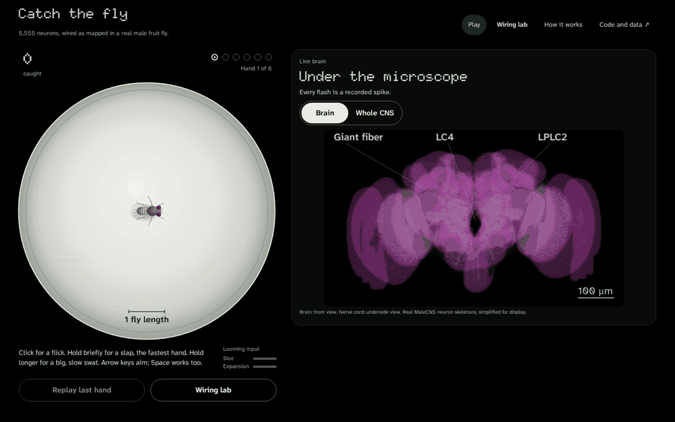
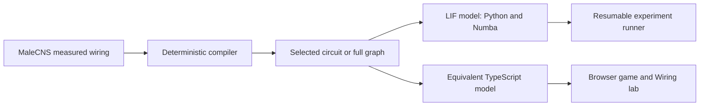

# Catch the Fly

A fly brain simulated from its real wiring. Try to swat it, then look inside its head.

**[Play Catch the Fly](https://alpi157.github.io/internet-vs-one-fly/)**



Walking runs at real speed. The swat and takeoff are slowed 5x, followed by 3 s of quarter-speed recorded replay with the giant fiber lit and the scrubber visibly advancing. Takeoff began before impact. [Capture rule, seeds tried and identities](docs/media/media-provenance.json).

- **Science:** [preregistered comparisons](docs/preregistration-v2.1.md), a stricter input-strength control that overturned part of the headline, and [raw records with a DOI](https://doi.org/10.5281/zenodo.23409752).
- **Engineering:** [bit-exact parity across Python, Numba, TypeScript and three browsers](packages/kernel-ts/test/browser-parity.mjs), WebGL rendering of [real neuron skeletons](docs/ui-v2h.md), and [reproducible acceptance](tools/acceptance.json).
- **Game:** click or tap for a fast hand; hold at least 300 ms for a big, slow hand. Replay recorded spikes, then explore the Wiring lab. No account or tracking.

## The finding

In this model, measured wiring stays calm at couplings where shuffles that keep each neuron's partner counts and signs saturate.

A stricter preregistered control that also approximately keeps each neuron's total input strength removes most of that gap.

Rates at coupling 0.039 in the registered comparisons:

| Graph | Measured rate | Earlier shuffle medians and Holm p | N-STRENGTH median and Holm p | Verdict |
|---|---:|---|---|---|
| T1a | 2.65 Hz | N-FULL 113.67 Hz (Holm p 0.008); N-CONTEXT 110.73 Hz (Holm p 0.008); N-SIGN 119.78 Hz (Holm p 0.008) | N-STRENGTH 4.40 Hz (Holm p 0.088) | The stricter control removes most of the rate gap; its comparison is not significant. |
| Full MaleCNS | 15.31 Hz | N-SIGN 36.84 Hz (Holm p 0.04) | N-STRENGTH 14.48 Hz (Holm p 0.14) | No significant rate difference from the stricter control. |
| T2 | 10.00 Hz | N-FULL 72.08 Hz (Holm p 0.02); N-SIGN 29.66 Hz (Holm p 0.02) | N-STRENGTH 4.99 Hz (Holm p 0.02) | Measured wiring is faster than N-STRENGTH, the opposite direction. |

EXPLORATORY: the earlier shuffles flattened the input-strength distribution in T1a (Gini about 0.47, versus 0.65 measured), while N-STRENGTH kept it close (about 0.64). This suggests that, in this model, stability mainly reflects how unevenly input strength is spread across neurons rather than which partners connect. This explanation was not a preregistered mechanism test; the E1 descriptors were preregistered as exploratory.

N-STRENGTH preserves incoming partner counts within sign and contact-count bins; its preservation of total input strength is approximate. These results apply only to this simplified model, with no claims about living flies. A non-significant result does not establish equivalence. Escape and walking comparisons remain insufficient.

The [original pre-registration](docs/preregistration-v2.md) was publicly timestamped on **2026-10-14** and the [robustness protocol](docs/preregistration-v2.1.md) on **2026-10-15**, before their runs. [Full family results and limits](docs/findings-v2f.md).


The Wiring lab recording walks through step 1 (N-SIGN) then step 2 (N-STRENGTH) at the registered test strength. Live numbers are separate from registered results. [Media provenance](docs/media/media-provenance.json) records seeds, identities and capture details.

## How it works



Visual features enter neural input ports. Spikes reach a motor decoder that receives no hand position, distance or future collision information. The previous command drives the current interval, so a new escape cannot alter an earlier hit.

## Engineering highlights

- Bit-exact state-digest checks cover Python, Numba, TypeScript, Chromium, Firefox and WebKit within the declared execution envelope.
- Publicly timestamped protocols and freeze manifests pin code, graph identities, assumptions, seeds and analysis before confirmatory execution.
- Atomic per-task results and deterministic seeds support resume independently of worker scheduling. The robustness run took **7.11 hours** on a **24-thread** host, with peak process RSS **5.17 GiB**.
- Offline fixtures, cross-runtime parity, scripted bots, browser screenshots, production base-path checks and fresh-clone acceptance make the implementation inspectable. [Measurement details](docs/measurements-v2f.json) state each scope.

## Run locally

Use the locked Python and Node development setup. Committed browser data means local play needs no credentials, GPU or connectome download.

```sh
uv sync --extra dev --locked
npm --prefix apps/play ci
npm --prefix apps/play run dev
```

Open the localhost URL printed by Vite with the `/internet-vs-one-fly/` base path. The Pages workflow is manual-only. Deployment remains an operator action.

## For scientists

The wiring model does not walk on its own. The game adds a declared random drive to the walking neurons (game profile v2.9). Escape comes only from vision through the network. The walking setting was chosen by the author after playtesting four candidates that passed the same safety checks.

[Walking design and evidence](docs/walking-v2j.md)

Game v2.9 has two hands: a press shorter than 300 ms uses the existing flick (speed 0.04, radius 0.8); a press of 300 ms or longer uses the existing swat (speed 0.025, radius 1.4). Flight lasts 330 ms at 0.018 arena units/ms, a 5.94-unit path. The first 120 ms, direction jitter and wall reflection stay as in v2.8. [Active game profile](profiles/game-v2.json) · [V2L design and validation](docs/ui-v2l.md).

Lab simulations have no walking drive.

The game executes a calibrated **5,555-neuron** circuit. The Wiring lab executes **2,641 neurons** in each simulation. The full accepted graph contains **166,700 neurons**. Original body IDs and contact counts remain separate from executable weights. Unknown signs remain disabled. BrainView uses pinned MaleCNS skeletons in a composite of the brain frontal view and nerve cord underside view, simplified for display.

The model uses uniform current-based LIF neurons, assumed source signs, feature-level vision, declared turn-direction assumptions and abstract takeoff physics. Noise excludes visual and decoder ports. Moving the coupling slider explicitly resets both simulations with the same seed; normal game rounds retain neural state. Dropping the hand adds visual input to both neural simulations.

**Escape and walking comparisons remain insufficient.** The selected real circuit calibrated, but only 21/199 N-FULL, 0/199 N-CONTEXT, 37/199 N-SIGN nulls did. The preregistered threshold was not reached. There are no confirmatory escape or walking superiority claims.

### CONFIRMATORY robustness

| Test | Circuit | Family | Metric | Real | Null median | 95% null band | p | Holm p | Verdict |
|---|---|---|---|---:|---:|---|---:|---:|---|
| H0-STR | T1a | N-STRENGTH | H0a | >0.1 (censored) | 0.1 | [0.08, >0.1 (censored)] | 0.06 | 0.088 | Not significant; does not establish the stability difference |
| H0-STR | T1a | N-STRENGTH | H0b | 2.65068 | 4.40042 | [2.66566, 8.81602] | 0.044 | 0.088 | Not significant; does not establish the stability difference |
| H0-FULL | FULL | N-SIGN | H0b-FULL | 15.3095 | 36.8414 | [34.5855, 38.8966] | 0.02 | 0.04 | Supports the registered stability direction |
| H0-FULL | FULL | N-STRENGTH | H0b-FULL | 15.3095 | 14.4829 | [13.4391, 15.4853] | 0.14 | 0.14 | Not significant; does not establish the stability difference |
| H0-T2 | T2 | N-FULL | H0a | >0.1 (censored) | 0.039 | [0.03, 0.039] | 0.01 | 0.02 | Supports the registered stability direction |
| H0-T2 | T2 | N-FULL | H0b | 10.0006 | 72.0766 | [52.6434, 87.3415] | 0.01 | 0.02 | Supports the registered stability direction |
| H0-T2 | T2 | N-SIGN | H0a | >0.1 (censored) | 0.05 | [0.05, 0.06] | 0.01 | 0.02 | Supports the registered stability direction |
| H0-T2 | T2 | N-SIGN | H0b | 10.0006 | 29.658 | [16.9921, 42.2049] | 0.01 | 0.02 | Supports the registered stability direction |
| H0-T2 | T2 | N-STRENGTH | H0a | >0.1 (censored) | >0.1 (censored) | [>0.1 (censored), >0.1 (censored)] | 1 | 1 | Not significant; does not establish the stability difference |
| H0-T2 | T2 | N-STRENGTH | H0b | 10.0006 | 4.98657 | [2.72369, 6.99636] | 0.01 | 0.02 | Opposite direction: measured rate is higher |

Critical coupling above the tested grid is censored. A non-significant result does not establish equivalence. A significant opposite-direction rate does not support the registered stability claim. Full [findings](docs/findings-v2f.md) include figures, null bands, censoring and exact [result tables](docs/results-v2f.json).

### EXPLORATORY checks

EXPLORATORY E1: measured leading signed eigenvalues are 3.04103 for T1a and 6.91182 for T2, above every family median; 2 null eigenvalues did not converge and remain missing. Structure and Spearman associations are descriptive, not a causal mechanism test.

EXPLORATORY E2a (glutamate treated as excitatory): measured rate 139.557 Hz versus null median 264.911 Hz; measured critical coupling 0.015 versus null median 0.01. Measured rate percentile 0%; critical-coupling percentile 100%. Both measured and shuffled wiring saturate under this sign assumption.

EXPLORATORY E3-low (lower noise): measured rate 1.52497 Hz versus null median 116.096 Hz; measured critical coupling >0.1 (censored) versus null median 0.03. Measured rate percentile 0%; critical-coupling percentile 100%.

EXPLORATORY E3-high (higher noise): measured rate 4.13383 Hz versus null median 119.603 Hz; measured critical coupling >0.1 (censored) versus null median 0.03. Measured rate percentile 0%; critical-coupling percentile 100%.

EXPLORATORY E2b: preregistered SKIPPED. Compiled predicted_nt_confidence is copied verbatim, but the source confidence semantics and its relationship to consensus_nt signs are not established. No threshold interpretation is invented.

[Original findings](docs/findings-v2e.md) · [Original tables](docs/results-v2e.json) · [Robustness freeze manifest](profiles/freeze-v2.1.json).

Verify the existing raw records without simulating new trials:

```sh
uv run python tools/restore_evidence.py --archive /path/to/flybench-raw-records-v2e-v2f.tar.gz
uv pip install --no-deps -r profiles/requirements-v2.1.txt
uv run python tools/recompute_v2e.py
uv run python experiments/v2e_analyze.py --out evidence/V2E/results --verify
uv run python experiments/v2f_analyze.py --out evidence/V2F/results --verify
uv run python experiments/v2f_publish.py --check
```

The raw-record dataset DOI is [10.5281/zenodo.23409752](https://doi.org/10.5281/zenodo.23409752). `uv run python tools/restore_evidence.py --download` retrieves the checksum-pinned archive. Both frozen verifiers run offline after restoration; the older verifier also compares recorded host metadata, so its exact equality check requires the recorded platform and thread-count envelope. `tools/recompute_v2e.py` is independent of that frozen CLI verifier: it uses the same frozen analysis functions and compares every result field against the committed tables, ignoring only `hardware`. It restores nothing and works outside the recorded host envelope. Verification processes the raw records without running a simulation. Reproducing the registered experiment from scratch requires the pinned sources and graphs in the [data guide](docs/data-attribution.md), plus the exact commands and worker plan in the [protocol](docs/preregistration-v2.1.md). The completed run's elapsed time above is a measurement, not a runtime guarantee. Do not patch a frozen executable to continue an attempt.

## Limitations

The strength-preserving comparisons did not replicate the registered stability result. There is no learning, plasticity, realistic biomechanics, human-player study, public verification service or shared score. Scripted bot results are engineering evidence, not human usability evidence. EXPLORATORY analyses cannot support confirmatory claims. A difference from a shuffle does not establish biological necessity or identify a unique mechanism.

## Data attribution, citation and license

MaleCNS is published by the Male CNS Connectome project, including FlyEM at HHMI Janelia, Cambridge, MRC LMB and Google Research. The [official download page](https://male-cns.janelia.org/download/) identifies the CC-BY license. Cite the [MaleCNS study](https://www.cell.com/cell/fulltext/S0092-8674%2826%2900942-6) and [dataset release](https://male-cns.janelia.org/).

Source URLs and observed hashes are in [source-lock.json](profiles/source-lock.json). Browser asset attribution and hashes accompany the committed data. See [CITATION.cff](CITATION.cff) for software and dataset citation metadata. Code is [MIT licensed](LICENSE); underlying and derived MaleCNS data remains [CC-BY](LICENSE-DATA.md).
