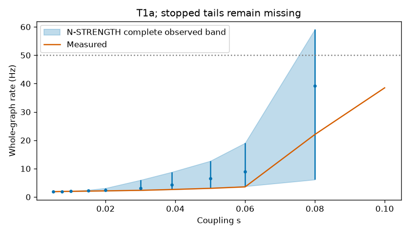
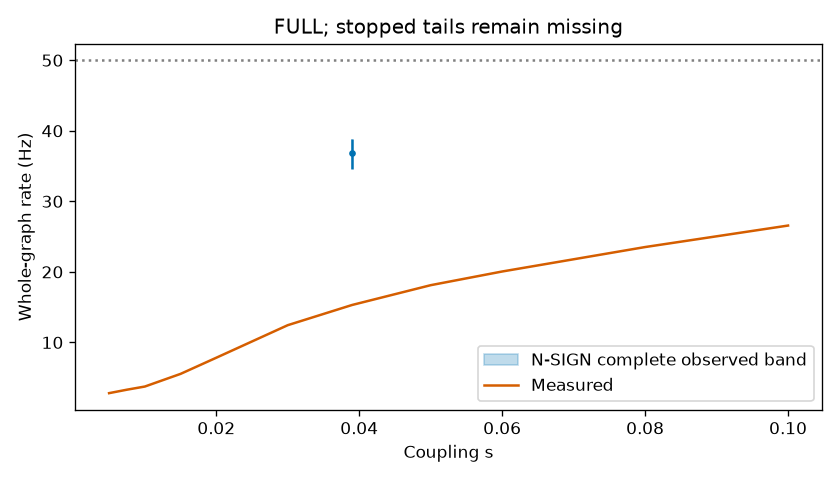
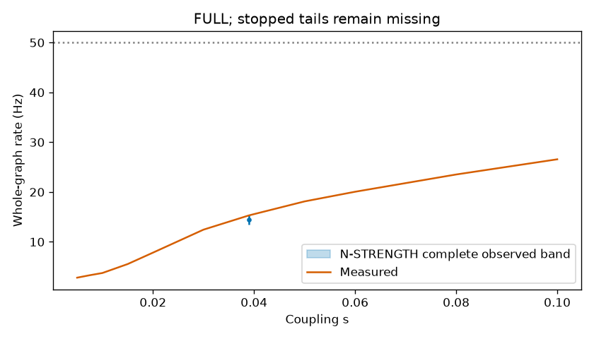
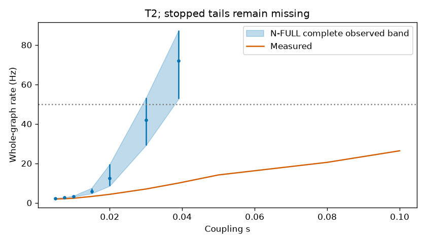
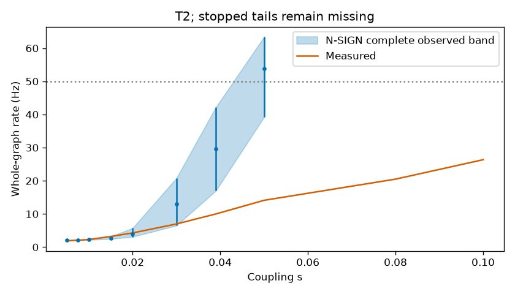
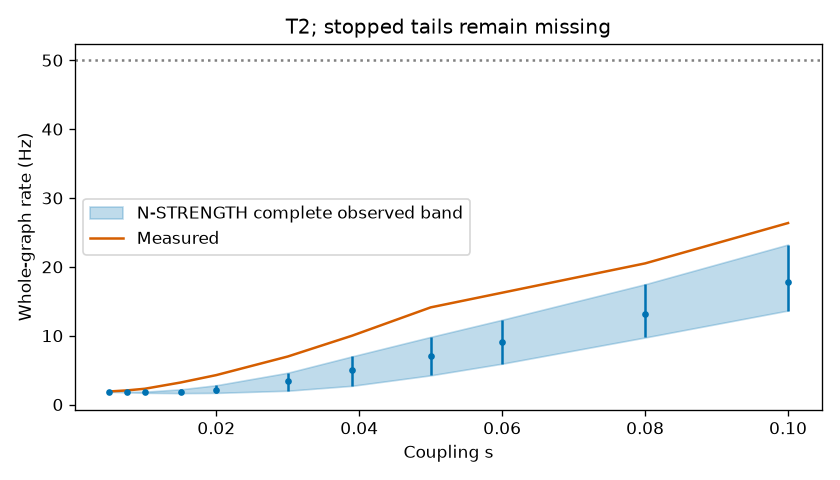

# Robustness findings

Generated from [results-v2f.json](results-v2f.json), the unchanged frozen analysis tables.

## CONFIRMATORY

The strength-preserving comparison did not replicate the registered stability result in the 2,641-neuron circuit: N-STRENGTH had Holm p 0.088 for both metrics.

The stability difference also holds in the full 166,700-neuron MaleCNS graph, under this model and for the families that reached significance. N-SIGN reached Holm p 0.04; N-STRENGTH did not replicate (Holm p 0.14).

The stability difference also holds in the 43,894-neuron circuit, under this model and for the families that reached significance. N-FULL and N-SIGN each reached Holm p 0.02 for both metrics; N-STRENGTH did not replicate: its critical-coupling comparison was not significant (Holm p 1), and its measured rate was higher, the opposite direction (Holm p 0.02).

| Test | Circuit | Family | Metric | Real | Null median | 95% null band | p | Holm p | Verdict |
|---|---|---|---|---:|---:|---|---:|---:|---|
| H0-STR | T1a | N-STRENGTH | H0a | >0.1 (censored) | 0.1 | [0.08, >0.1 (censored)] | 0.06 | 0.088 | Not significant; does not establish the stability difference |
| H0-STR | T1a | N-STRENGTH | H0b | 2.65068 | 4.40042 | [2.66566, 8.81602] | 0.044 | 0.088 | Not significant; does not establish the stability difference |
| H0-FULL | FULL | N-SIGN | H0b-FULL | 15.3095 | 36.8414 | [34.5855, 38.8966] | 0.02 | 0.04 | Supports the registered stability direction |
| H0-FULL | FULL | N-STRENGTH | H0b-FULL | 15.3095 | 14.4829 | [13.4391, 15.4853] | 0.14 | 0.14 | Not significant; does not establish the stability difference |
| H0-T2 | T2 | N-FULL | H0a | >0.1 (censored) | 0.039 | [0.03, 0.039] | 0.01 | 0.02 | Supports the registered stability direction |
| H0-T2 | T2 | N-FULL | H0b | 10.0006 | 72.0766 | [52.6434, 87.3415] | 0.01 | 0.02 | Supports the registered stability direction |
| H0-T2 | T2 | N-SIGN | H0a | >0.1 (censored) | 0.05 | [0.05, 0.06] | 0.01 | 0.02 | Supports the registered stability direction |
| H0-T2 | T2 | N-SIGN | H0b | 10.0006 | 29.658 | [16.9921, 42.2049] | 0.01 | 0.02 | Supports the registered stability direction |
| H0-T2 | T2 | N-STRENGTH | H0a | >0.1 (censored) | >0.1 (censored) | [>0.1 (censored), >0.1 (censored)] | 1 | 1 | Not significant; does not establish the stability difference |
| H0-T2 | T2 | N-STRENGTH | H0b | 10.0006 | 4.98657 | [2.72369, 6.99636] | 0.01 | 0.02 | Opposite direction: measured rate is higher |

H0a is critical coupling; >0.1 means censored above the tested grid. The stored 0.11 is a rank sentinel, never a measured coupling. H0b and H0b-FULL are whole-graph rates in Hz at coupling 0.039. Bands are descriptive null percentiles, not confidence intervals on an effect. Non-significant outcomes do not establish equivalence. A significant opposite-direction rate does not support the registered stability claim.

- H0-STR (T1a), N-STRENGTH: the registered stability result did not replicate. H0a: Holm p 0.088, not significant; does not establish the stability difference; H0b: Holm p 0.088, not significant; does not establish the stability difference.
- H0-FULL (FULL), N-SIGN: the stability difference holds under this model. H0b-FULL: Holm p 0.04, supports the registered stability direction.
- H0-FULL (FULL), N-STRENGTH: the registered stability result did not replicate. H0b-FULL: Holm p 0.14, not significant; does not establish the stability difference.
- H0-T2 (T2), N-FULL: the stability difference holds under this model. H0a: Holm p 0.02, supports the registered stability direction; H0b: Holm p 0.02, supports the registered stability direction.
- H0-T2 (T2), N-SIGN: the stability difference holds under this model. H0a: Holm p 0.02, supports the registered stability direction; H0b: Holm p 0.02, supports the registered stability direction.
- H0-T2 (T2), N-STRENGTH: the registered stability result did not replicate. H0a: Holm p 1, not significant; does not establish the stability difference; H0b: Holm p 0.02, opposite direction: measured rate is higher.








## EXPLORATORY

Descriptive percentiles and Spearman coefficients only.

EXPLORATORY E1: measured leading signed eigenvalues are 3.04103 for T1a and 6.91182 for T2, above every family median; 2 null eigenvalues did not converge and remain missing. Structure and Spearman associations are descriptive, not a causal mechanism test.

EXPLORATORY E2a (glutamate treated as excitatory): measured rate 139.557 Hz versus null median 264.911 Hz; measured critical coupling 0.015 versus null median 0.01. Measured rate percentile 0%; critical-coupling percentile 100%. Both measured and shuffled wiring saturate under this sign assumption.

EXPLORATORY E3-low (lower noise): measured rate 1.52497 Hz versus null median 116.096 Hz; measured critical coupling >0.1 (censored) versus null median 0.03. Measured rate percentile 0%; critical-coupling percentile 100%.

EXPLORATORY E3-high (higher noise): measured rate 4.13383 Hz versus null median 119.603 Hz; measured critical coupling >0.1 (censored) versus null median 0.03. Measured rate percentile 0%; critical-coupling percentile 100%.

EXPLORATORY E2b: preregistered SKIPPED. Compiled predicted_nt_confidence is copied verbatim, but the source confidence semantics and its relationship to consensus_nt signs are not established. No threshold interpretation is invented.

### EXPLORATORY assumption tables

| Check | Metric | Real | Null median | 95% null band | Measured percentile |
|---|---|---:|---:|---|---:|
| EXPLORATORY E2a | H0a | 0.015 | 0.01 | 0.01, 0.01 | 100% |
| EXPLORATORY E2a | H0b | 139.557 | 264.911 | 260.735, 268.16 | 0% |
| EXPLORATORY E3-low | H0a | >0.1 (censored) | 0.03 | 0.03, 0.03 | 100% |
| EXPLORATORY E3-low | H0b | 1.52497 | 116.096 | 100.17, 130.928 | 0% |
| EXPLORATORY E3-high | H0a | >0.1 (censored) | 0.03 | 0.03, 0.03 | 100% |
| EXPLORATORY E3-high | H0b | 4.13383 | 119.603 | 103.826, 135.942 | 0% |

### EXPLORATORY structure tables

| Circuit | Family | Descriptor | Real | Null median | 95% null band | Percentile | Valid | Missing |
|---|---|---|---:|---:|---|---:|---:|---:|
| T1a | N-FULL | leading_signed_eigenvalue | 3.04103 | 2.00492 | 1.86871, 2.23363 | 99.7996% | 499 | 0 |
| T1a | N-FULL | excitatory_spectral_radius | 4.57593 | 4.77376 | 4.67911, 4.87396 | 0% | 499 | 0 |
| T1a | N-FULL | excitatory_reciprocity | 0.280198 | 0.0403163 | 0.0391362, 0.0415419 | 100% | 499 | 0 |
| T1a | N-FULL | largest_excitatory_scc | 1749 | 1750 | 1748, 1751 | 17.0341% | 499 | 0 |
| T1a | N-FULL | contact_weighted_2_cycles | 2.11611e+06 | 326896 | 268675, 425459 | 100% | 499 | 0 |
| T1a | N-FULL | contact_weighted_3_cycles | 3.7453e+08 | 1.56444e+08 | 1.42291e+08, 1.78284e+08 | 100% | 499 | 0 |
| T1a | N-FULL | in_strength_gini | 0.646765 | 0.472676 | 0.468427, 0.476907 | 100% | 499 | 0 |
| T1a | N-CONTEXT | leading_signed_eigenvalue | 3.04103 | 2.01141 | 1.87601, 2.24987 | 100% | 498 | 1 |
| T1a | N-CONTEXT | excitatory_spectral_radius | 4.57593 | 4.76454 | 4.66881, 4.87878 | 0% | 499 | 0 |
| T1a | N-CONTEXT | excitatory_reciprocity | 0.280198 | 0.0403053 | 0.0389878, 0.0415297 | 100% | 499 | 0 |
| T1a | N-CONTEXT | largest_excitatory_scc | 1749 | 1750 | 1748, 1751 | 11.7234% | 499 | 0 |
| T1a | N-CONTEXT | contact_weighted_2_cycles | 2.11611e+06 | 322577 | 264036, 426028 | 100% | 499 | 0 |
| T1a | N-CONTEXT | contact_weighted_3_cycles | 3.7453e+08 | 1.54974e+08 | 1.424e+08, 1.76396e+08 | 100% | 499 | 0 |
| T1a | N-CONTEXT | in_strength_gini | 0.646765 | 0.474329 | 0.469895, 0.478489 | 100% | 499 | 0 |
| T1a | N-SIGN | leading_signed_eigenvalue | 3.04103 | 1.9964 | 1.86721, 2.20659 | 100% | 499 | 0 |
| T1a | N-SIGN | excitatory_spectral_radius | 4.57593 | 4.70819 | 4.6149, 4.81714 | 0.200401% | 499 | 0 |
| T1a | N-SIGN | excitatory_reciprocity | 0.280198 | 0.041579 | 0.0404753, 0.0427984 | 100% | 499 | 0 |
| T1a | N-SIGN | largest_excitatory_scc | 1749 | 1749 | 1749, 1749 | 50% | 499 | 0 |
| T1a | N-SIGN | contact_weighted_2_cycles | 2.11611e+06 | 316248 | 263842, 413251 | 100% | 499 | 0 |
| T1a | N-SIGN | contact_weighted_3_cycles | 3.7453e+08 | 1.50416e+08 | 1.36679e+08, 1.69863e+08 | 100% | 499 | 0 |
| T1a | N-SIGN | in_strength_gini | 0.646765 | 0.472609 | 0.468481, 0.477114 | 100% | 499 | 0 |
| T1a | N-STRENGTH | leading_signed_eigenvalue | 3.04103 | 2.35962 | 2.19014, 2.67099 | 100% | 498 | 1 |
| T1a | N-STRENGTH | excitatory_spectral_radius | 4.57593 | 4.9493 | 4.79831, 5.12803 | 0% | 499 | 0 |
| T1a | N-STRENGTH | excitatory_reciprocity | 0.280198 | 0.0409366 | 0.0397293, 0.0420143 | 100% | 499 | 0 |
| T1a | N-STRENGTH | largest_excitatory_scc | 1749 | 1749 | 1749, 1749 | 50.3006% | 499 | 0 |
| T1a | N-STRENGTH | contact_weighted_2_cycles | 2.11611e+06 | 354593 | 282184, 466027 | 100% | 499 | 0 |
| T1a | N-STRENGTH | contact_weighted_3_cycles | 3.7453e+08 | 1.74106e+08 | 1.51692e+08, 2.06555e+08 | 100% | 499 | 0 |
| T1a | N-STRENGTH | in_strength_gini | 0.646765 | 0.643338 | 0.642759, 0.64394 | 100% | 499 | 0 |
| T2 | N-FULL | leading_signed_eigenvalue | 6.91182 | 2.60021 | 2.33999, 4.90429 | 100% | 20 | 0 |
| T2 | N-FULL | excitatory_spectral_radius | 8.43025 | 7.05563 | 7.0189, 7.09753 | 100% | 20 | 0 |
| T2 | N-FULL | excitatory_reciprocity | 0.162741 | 0.00863089 | 0.00849184, 0.00870567 | 100% | 20 | 0 |
| T2 | N-FULL | largest_excitatory_scc | 30888 | 30919 | 30913.5, 30921.5 | 0% | 20 | 0 |
| T2 | N-FULL | contact_weighted_2_cycles | 2.05373e+07 | 1.00295e+06 | 882373, 1.06169e+06 | 100% | 20 | 0 |
| T2 | N-FULL | contact_weighted_3_cycles | 3.91774e+09 | 5.09974e+08 | 5.01652e+08, 5.22546e+08 | 100% | 20 | 0 |
| T2 | N-FULL | in_strength_gini | 0.63984 | 0.526049 | 0.525413, 0.526784 | 100% | 20 | 0 |
| T2 | N-SIGN | leading_signed_eigenvalue | 6.91182 | 2.53624 | 2.35346, 5.79893 | 100% | 20 | 0 |
| T2 | N-SIGN | excitatory_spectral_radius | 8.43025 | 7.059 | 7.02188, 7.07977 | 100% | 20 | 0 |
| T2 | N-SIGN | excitatory_reciprocity | 0.162741 | 0.00866149 | 0.00857334, 0.00883558 | 100% | 20 | 0 |
| T2 | N-SIGN | largest_excitatory_scc | 30888 | 30900 | 30896.5, 30904 | 0% | 20 | 0 |
| T2 | N-SIGN | contact_weighted_2_cycles | 2.05373e+07 | 957198 | 890955, 1.08165e+06 | 100% | 20 | 0 |
| T2 | N-SIGN | contact_weighted_3_cycles | 3.91774e+09 | 5.09575e+08 | 4.97067e+08, 5.44169e+08 | 100% | 20 | 0 |
| T2 | N-SIGN | in_strength_gini | 0.63984 | 0.525767 | 0.525091, 0.526512 | 100% | 20 | 0 |
| T2 | N-STRENGTH | leading_signed_eigenvalue | 6.91182 | 3.61802 | 3.36665, 5.09226 | 100% | 20 | 0 |
| T2 | N-STRENGTH | excitatory_spectral_radius | 8.43025 | 8.7356 | 8.65542, 8.85755 | 0% | 20 | 0 |
| T2 | N-STRENGTH | excitatory_reciprocity | 0.162741 | 0.00864295 | 0.00852361, 0.00875436 | 100% | 20 | 0 |
| T2 | N-STRENGTH | largest_excitatory_scc | 30888 | 30901 | 30896.5, 30903.5 | 0% | 20 | 0 |
| T2 | N-STRENGTH | contact_weighted_2_cycles | 2.05373e+07 | 1.29154e+06 | 1.1446e+06, 1.78e+06 | 100% | 20 | 0 |
| T2 | N-STRENGTH | contact_weighted_3_cycles | 3.91774e+09 | 9.70203e+08 | 9.12468e+08, 1.04777e+09 | 100% | 20 | 0 |
| T2 | N-STRENGTH | in_strength_gini | 0.63984 | 0.636666 | 0.636597, 0.636742 | 100% | 20 | 0 |

### EXPLORATORY correlations

| Circuit | Family | Descriptor | Outcome | Pairs | Spearman rho |
|---|---|---|---|---:|---:|
| T1a | N-FULL | leading_signed_eigenvalue | H0a | 499 | -0.0894229 |
| T1a | N-FULL | leading_signed_eigenvalue | H0b | 499 | 0.0656838 |
| T1a | N-FULL | excitatory_spectral_radius | H0a | 499 | -0.156328 |
| T1a | N-FULL | excitatory_spectral_radius | H0b | 499 | 0.338457 |
| T1a | N-FULL | excitatory_reciprocity | H0a | 499 | -0.0650906 |
| T1a | N-FULL | excitatory_reciprocity | H0b | 499 | 0.0543116 |
| T1a | N-FULL | largest_excitatory_scc | H0a | 499 | 0.0179046 |
| T1a | N-FULL | largest_excitatory_scc | H0b | 499 | 0.0214931 |
| T1a | N-FULL | contact_weighted_2_cycles | H0a | 499 | -0.0644026 |
| T1a | N-FULL | contact_weighted_2_cycles | H0b | 499 | 0.108565 |
| T1a | N-FULL | contact_weighted_3_cycles | H0a | 499 | -0.0765595 |
| T1a | N-FULL | contact_weighted_3_cycles | H0b | 499 | 0.145945 |
| T1a | N-FULL | in_strength_gini | H0a | 499 | 0.00812238 |
| T1a | N-FULL | in_strength_gini | H0b | 499 | -0.025199 |
| T1a | N-CONTEXT | leading_signed_eigenvalue | H0a | 498 | -0.118947 |
| T1a | N-CONTEXT | leading_signed_eigenvalue | H0b | 498 | 0.197954 |
| T1a | N-CONTEXT | excitatory_spectral_radius | H0a | 499 | -0.222634 |
| T1a | N-CONTEXT | excitatory_spectral_radius | H0b | 499 | 0.409811 |
| T1a | N-CONTEXT | excitatory_reciprocity | H0a | 499 | 0.0114572 |
| T1a | N-CONTEXT | excitatory_reciprocity | H0b | 499 | 0.0782202 |
| T1a | N-CONTEXT | largest_excitatory_scc | H0a | 499 | 0.0206268 |
| T1a | N-CONTEXT | largest_excitatory_scc | H0b | 499 | -0.0445873 |
| T1a | N-CONTEXT | contact_weighted_2_cycles | H0a | 499 | -0.0620398 |
| T1a | N-CONTEXT | contact_weighted_2_cycles | H0b | 499 | 0.0604911 |
| T1a | N-CONTEXT | contact_weighted_3_cycles | H0a | 499 | -0.110802 |
| T1a | N-CONTEXT | contact_weighted_3_cycles | H0b | 499 | 0.279251 |
| T1a | N-CONTEXT | in_strength_gini | H0a | 499 | 0.082314 |
| T1a | N-CONTEXT | in_strength_gini | H0b | 499 | -0.0165742 |
| T1a | N-SIGN | leading_signed_eigenvalue | H0a | 499 | -0.0781675 |
| T1a | N-SIGN | leading_signed_eigenvalue | H0b | 499 | 0.0955665 |
| T1a | N-SIGN | excitatory_spectral_radius | H0a | 499 | -0.0400746 |
| T1a | N-SIGN | excitatory_spectral_radius | H0b | 499 | 0.303888 |
| T1a | N-SIGN | excitatory_reciprocity | H0a | 499 | -0.0721145 |
| T1a | N-SIGN | excitatory_reciprocity | H0b | 499 | 0.00978832 |
| T1a | N-SIGN | largest_excitatory_scc | H0a | 499 | missing |
| T1a | N-SIGN | largest_excitatory_scc | H0b | 499 | missing |
| T1a | N-SIGN | contact_weighted_2_cycles | H0a | 499 | -0.0893972 |
| T1a | N-SIGN | contact_weighted_2_cycles | H0b | 499 | 0.00918333 |
| T1a | N-SIGN | contact_weighted_3_cycles | H0a | 499 | -0.0369919 |
| T1a | N-SIGN | contact_weighted_3_cycles | H0b | 499 | 0.180251 |
| T1a | N-SIGN | in_strength_gini | H0a | 499 | 0.0297257 |
| T1a | N-SIGN | in_strength_gini | H0b | 499 | -0.0498909 |
| T1a | N-STRENGTH | leading_signed_eigenvalue | H0a | 498 | -0.0364294 |
| T1a | N-STRENGTH | leading_signed_eigenvalue | H0b | 498 | 0.0797465 |
| T1a | N-STRENGTH | excitatory_spectral_radius | H0a | 499 | -0.0883003 |
| T1a | N-STRENGTH | excitatory_spectral_radius | H0b | 499 | 0.179633 |
| T1a | N-STRENGTH | excitatory_reciprocity | H0a | 499 | -0.0205678 |
| T1a | N-STRENGTH | excitatory_reciprocity | H0b | 499 | 0.0162208 |
| T1a | N-STRENGTH | largest_excitatory_scc | H0a | 499 | 0.0308038 |
| T1a | N-STRENGTH | largest_excitatory_scc | H0b | 499 | 0.0457113 |
| T1a | N-STRENGTH | contact_weighted_2_cycles | H0a | 499 | -0.0171665 |
| T1a | N-STRENGTH | contact_weighted_2_cycles | H0b | 499 | 0.103474 |
| T1a | N-STRENGTH | contact_weighted_3_cycles | H0a | 499 | -0.0939728 |
| T1a | N-STRENGTH | contact_weighted_3_cycles | H0b | 499 | 0.144714 |
| T1a | N-STRENGTH | in_strength_gini | H0a | 499 | 0.0295087 |
| T1a | N-STRENGTH | in_strength_gini | H0b | 499 | -0.0510532 |
| T2 | N-FULL | leading_signed_eigenvalue | H0a | 20 | 0.012142 |
| T2 | N-FULL | leading_signed_eigenvalue | H0b | 20 | 0.0736842 |
| T2 | N-FULL | excitatory_spectral_radius | H0a | 20 | -0.012142 |
| T2 | N-FULL | excitatory_spectral_radius | H0b | 20 | 0.401504 |
| T2 | N-FULL | excitatory_reciprocity | H0a | 20 | -0.0364259 |
| T2 | N-FULL | excitatory_reciprocity | H0b | 20 | -0.162406 |
| T2 | N-FULL | largest_excitatory_scc | H0a | 20 | 0.0736876 |
| T2 | N-FULL | largest_excitatory_scc | H0b | 20 | -0.215223 |
| T2 | N-FULL | contact_weighted_2_cycles | H0a | 20 | -0.206413 |
| T2 | N-FULL | contact_weighted_2_cycles | H0b | 20 | 0.0135338 |
| T2 | N-FULL | contact_weighted_3_cycles | H0a | 20 | -0.133562 |
| T2 | N-FULL | contact_weighted_3_cycles | H0b | 20 | 0.209023 |
| T2 | N-FULL | in_strength_gini | H0a | 20 | -0.0849938 |
| T2 | N-FULL | in_strength_gini | H0b | 20 | -0.121805 |
| T2 | N-SIGN | leading_signed_eigenvalue | H0a | 20 | -0.113531 |
| T2 | N-SIGN | leading_signed_eigenvalue | H0b | 20 | -0.153383 |
| T2 | N-SIGN | excitatory_spectral_radius | H0a | 20 | 0.0189219 |
| T2 | N-SIGN | excitatory_spectral_radius | H0b | 20 | -0.0676692 |
| T2 | N-SIGN | excitatory_reciprocity | H0a | 20 | -0.123039 |
| T2 | N-SIGN | excitatory_reciprocity | H0b | 20 | 0.15645 |
| T2 | N-SIGN | largest_excitatory_scc | H0a | 20 | -0.0572192 |
| T2 | N-SIGN | largest_excitatory_scc | H0b | 20 | 0.0553257 |
| T2 | N-SIGN | contact_weighted_2_cycles | H0a | 20 | 0.378438 |
| T2 | N-SIGN | contact_weighted_2_cycles | H0b | 20 | -0.524812 |
| T2 | N-SIGN | contact_weighted_3_cycles | H0a | 20 | -0.0567657 |
| T2 | N-SIGN | contact_weighted_3_cycles | H0b | 20 | 0.0827068 |
| T2 | N-SIGN | in_strength_gini | H0a | 20 | 0.245985 |
| T2 | N-SIGN | in_strength_gini | H0b | 20 | -0.221053 |
| T2 | N-STRENGTH | leading_signed_eigenvalue | H0a | 20 | missing |
| T2 | N-STRENGTH | leading_signed_eigenvalue | H0b | 20 | 0.16391 |
| T2 | N-STRENGTH | excitatory_spectral_radius | H0a | 20 | missing |
| T2 | N-STRENGTH | excitatory_spectral_radius | H0b | 20 | 0.157895 |
| T2 | N-STRENGTH | excitatory_reciprocity | H0a | 20 | missing |
| T2 | N-STRENGTH | excitatory_reciprocity | H0b | 20 | 0.299248 |
| T2 | N-STRENGTH | largest_excitatory_scc | H0a | 20 | missing |
| T2 | N-STRENGTH | largest_excitatory_scc | H0b | 20 | -0.136923 |
| T2 | N-STRENGTH | contact_weighted_2_cycles | H0a | 20 | missing |
| T2 | N-STRENGTH | contact_weighted_2_cycles | H0b | 20 | -0.159398 |
| T2 | N-STRENGTH | contact_weighted_3_cycles | H0a | 20 | missing |
| T2 | N-STRENGTH | contact_weighted_3_cycles | H0b | 20 | 0.0631579 |
| T2 | N-STRENGTH | in_strength_gini | H0a | 20 | missing |
| T2 | N-STRENGTH | in_strength_gini | H0b | 20 | 0.27218 |

All null-distribution and EXPLORATORY scatter figures are in the review archive under evidence/results/figures/. Censored critical couplings share the top rank; constant quantities have missing correlations. No stopped curve tails or failed spectra were filled.

## Compute and limits

Elapsed invocation: 25612.696 seconds (7.115 hours). Summed task time: 63345.880 seconds. Peak process high-water RSS: 5,423,064 KiB. Hardware threads: 24. Worker counts were full graph 1, T2 4, small circuits 8, mechanism 2. RSS is a process high-water mark, not an isolated incremental allocation for each task.

Uniform model neurons, assumed transmitter signs and simplified inputs limit these findings to this model. Escape and walking comparisons remain insufficient; no claim concerns what living flies require.

No scientific protocol deviation or replacement was made. The EXPLORATORY E2b skip and numerical nonconvergence handling were preregistered. Data hashes, task identity checks, synthetic null invariants, censoring and analysis checks passed; no frozen code was patched to obtain these conclusions. The opposite-direction T2 N-STRENGTH outcome is retained.

```sh
uv run python experiments/v2f_analyze.py --out evidence/V2F/results
uv run python experiments/v2f_analyze.py --out evidence/V2F/results --verify
uv run python experiments/v2f_publish.py --check
```
